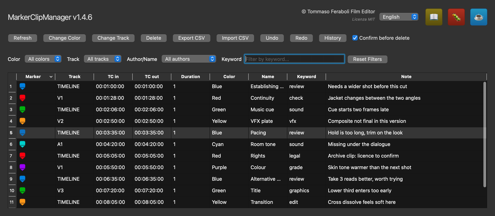

# MarkerClipManager

**Marker manager for DaVinci Resolve.**
One window to see and change every marker in a timeline — the ones on the ruler
and the ones on individual clips, across all video and audio tracks, together.

🇮🇹 [Leggi in italiano](README.it.md)

*Every marker in the timeline in one table — ruler and clip markers together.
Sample data.*

---

## The problem this solves

Markers pile up on a long edit. Review notes, VFX flags, music cues, reminders —
some on the timeline ruler, some stuck on individual clips, spread over a dozen
tracks.

Resolve shows them, but one at a time. There is no way to see clip markers and
ruler markers in the same list, no way to filter them, and no way to act on
forty of them at once. Recolouring a round of review notes means opening forty
dialogs.

MarkerClipManager puts them all in one table: filter it, select what you want,
change it in one go.

Written by a working film editor, for his own edits.

---

## What it does

Every marker in the timeline, in one sortable table: marker graphic, track,
TC in, TC out, duration, colour, name, keyword, note.

**Change things, one marker or forty at a time**

- Colour, track (including moving markers to and from the `TIMELINE` ruler), delete
- Name, Keyword and Note edited straight in the table — double-click a cell, and
  the change applies to every marker you have selected
- `Delete` on the keyboard does the same as the Delete button, with an optional
  confirmation you can switch off

**Find things**

- Filter by colour, track, author/name, or free-text keyword
- Click a row and the timeline playhead jumps to that marker

**Undo what you did**

- `Cmd+Z` / `Ctrl+Z`, and a History panel: double-click any earlier step to jump
  straight back to it, the way an image editor does
- Covers colour, track, inline edits, deletions and CSV imports made in the
  session. It does not persist after you close the script

**Move markers in and out**

- Export and import as CSV

**In your language**

- The interface is translated into 12 languages — English, Italian, French,
  German, Spanish, Portuguese, Russian, Japanese, Korean, Chinese, Vietnamese,
  Thai. It starts in your system language if there is a match, otherwise in
  English, and there is a language menu in the header (it takes effect when you
  restart the script)

---

## Installation

Download the installer for your system from the
[Releases page](../../releases), then:

**macOS** — **right-click** the `.command` file and choose **Open**
(not a double-click: the installer is not signed with an Apple certificate, and
a double-click gets blocked with a message about an unidentified developer).

**Windows** — double-click the `.cmd` file. If SmartScreen warns you, choose
*More info* → *Run anyway*.

The installer copies the files and then prepares the Python environment the
script needs. If that second part fails — no internet, no Python — the files are
still installed correctly, and it tells you how to finish later.

Then, in Resolve:

    Workspace > Scripts > Comp > MarkerClipManager > MarkerClipManager

Installing by hand instead? Everything in `scripts/` goes into one folder:
`Fusion/Scripts/Comp/MarkerClipManager/`, keeping the `strings/` subfolder
inside it. Then run `MarkerClipManager_Setup.command` (macOS) or
`MarkerClipManager_Setup_Windows.cmd` to install PySide6.

---

## Requirements

- **DaVinci Resolve 19 or 20**
- **Python 3**, and PySide6 — the installer sets this up for you, in a
  virtual environment of its own on macOS so it does not touch your system Python
- macOS or Windows

> **Studio or free version?** Used daily on Resolve Studio. Whether it runs on
> the free version has not been tested. The interface is built with PySide6, not
> Resolve's UIManager — so it does *not* hit the limit that makes UIManager
> scripts Studio-only from Resolve 19.1 onwards — but the scripting API it uses
> to read the timeline has not been verified on the free version. If you try it
> there, please [open an Issue](../../issues) and say how it went.

---

## Known limits

- **Windows is built but untested.** The installer and the Windows setup script
  exist and the code paths are there, but nobody has yet run it on a real
  Windows machine. Reports welcome
- **Keyword is not a native Resolve field.** Resolve markers have no keyword, so
  it is stored in the marker's `customData`. It is invisible to Resolve's own
  Marker panel — only this script reads and writes it
- **The marker icon is a recreation**, drawn by the script. Resolve does not
  expose its own icon. The colours are exact; the shape is an approximation
- **Undo does not persist** between runs, and does not notice markers you change
  directly in Resolve while the script is open
- **Moving a marker onto a video or audio track** needs a clip already at that
  position — Resolve does not allow a marker floating on an empty track. Moving
  to the `TIMELINE` ruler always works
- **Timecode** reads the frame rate and drop-frame mode from the timeline
  (29.97 and 59.94 DF handled with the standard SMPTE algorithm). On unusual or
  variable frame rates the result is approximate
- **EDL marker import/export is not here** — Resolve does that natively
  (Timeline > Markers > Export/Import). This script handles CSV
- **The 12 translations were generated automatically** and checked for structure,
  not for the quality of each language. Typos and awkward phrasing are likely:
  corrections are welcome

---

## Documentation

- [User guide](docs/) — the same guide in 12 languages
- [CHANGELOG](CHANGELOG.md) — what changed in each version

---

## Reporting a problem

Open an [Issue](../../issues) — it is the best way, because the next person with
the same problem finds the answer already written.

The script also has a 🐛 button that opens a pre-filled email with your system
details, and keeps a log file you can attach:

- macOS: `~/Library/Logs/RepertoireDB/repertoire_db.log`
- Windows: `%LOCALAPPDATA%\Blackmagic Design\DaVinci Resolve\Logs\RepertoireDB\`

A note on what you are dealing with: this is written by an editor, not a
professional developer. The code works and is used on real edits, but do not
expect the conventions of a software project.

---

## Credits

**Tommaso Feraboli** — Film Editor
Licensed under [MIT](LICENSE.md) · Copyright (c) 2024-2026

If it saves you time: [buy me a coffee](https://paypal.me/acoffeefortom) ☕
